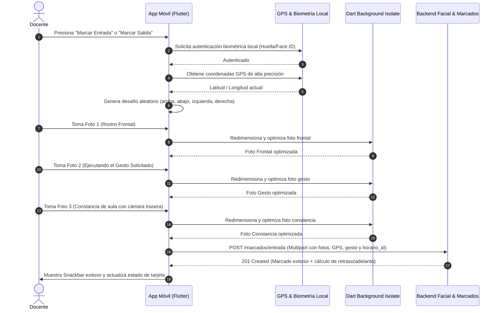

# 📱 Mi Control UPEA — Sistema de Asistencia Docente con Reconocimiento Facial

> **Aplicación móvil de control de asistencia docente con verificación biométrica facial, geocercas poligonales en Google Maps, detección de vida (anti-spoofing) y notificaciones programadas en tiempo real.**  
> Desarrollado para la **Universidad Pública de El Alto (UPEA)** — Carrera de Medicina.

---

## 📌 Tabla de Contenidos

- [Descripción General](#-descripción-general)
- [Características Principales](#-características-principales)
- [Arquitectura del Proyecto](#-arquitectura-del-proyecto)
- [Estructura del Código](#-estructura-del-código)
- [Flujos Principales del Sistema](#-flujos-principales-del-sistema)
  - [1. Autenticación y Seguridad](#1-autenticación-y-seguridad)
  - [2. Registro Facial con Guía por Voz (TTS)](#2-registro-facial-con-guía-por-voz-tts)
  - [3. Proceso de Marcado de Asistencia (Entrada / Salida)](#3-proceso-de-marcado-de-asistencia-entrada--salida)
  - [4. Geocercas Poligonales y Mapas en Vivo](#4-geocercas-poligonales-y-mapas-en-vivo)
  - [5. Notificaciones Locales y Alarmas Programadas](#5-notificaciones-locales-y-alarmas-programadas)
  - [6. Historial de Marcados y Filtros](#6-historial-de-marcados-y-filtros)
  - [7. Deep Links y Recuperación de Contraseña](#7-deep-links-y-recuperación-de-contraseña)
- [Catálogo de Endpoints de la API](#-catálogo-de-endpoints-de-la-api)
- [Configuración de Permisos en Android](#-configuración-de-permisos-en-android)
- [Tecnologías y Dependencias](#-tecnologías-y-dependencias)
- [Instalación y Puesta en Marcha](#-instalación-y-puesta-en-marcha)
- [Variables de Entorno y Configuración de Red](#-variables-de-entorno-y-configuración-de-red)

---

## 📖 Descripción General

**Mi Control UPEA** es una solución móvil desarrollada en Flutter diseñada para garantizar la asistencia presencial y puntual de los docentes universitarios en sus respectivas aulas, clínicas y laboratorios. 

Combina múltiples capas de validación y seguridad:
1. **Identidad del dispositivo y biometría local** (Huella dactilar / Face ID).
2. **Reconocimiento facial biométrico con detección de vida (Liveness Detection)**: Verificación contra embeddings faciales registrados, desafío dinámico de gestos y rechazo de suplantación (fotos/pantallas) y lentes.
3. **Geolocalización estricta por GPS y Geocercas poligonales**: Validación matemática de que el docente se encuentre dentro del polígono asignado para su materia y paralelo.
4. **Foto de constancia de entorno**: Registro de evidencia visual de la clase (cámara trasera).

---

## ✨ Características Principales

- 🔐 **Autenticación Biométrica y Cifrada**: Inicio de sesión mediante credenciales seguras, almacenamiento con `flutter_secure_storage`, biometría nativa (`local_auth`) y soporte para recordar sesión.
- 🗣️ **Asistencia por Voz Interactiva (TTS)**: Guía auditiva con `flutter_tts` que instruye al docente en cada ángulo facial y etapa del registro.
- 👤 **Enrollment Facial de 76 Embeddings**: Muestreo distribuido en 6 posturas faciales (Centro, Izquierda, Derecha, Arriba, Abajo y Sonrisa) para alta precisión de reconocimiento.
- ⚡ **Procesamiento de Imágenes en Isolates**: Redimensionamiento y compresión JPEG en segundo plano sin congelar la interfaz de usuario ni la cámara.
- 📍 **Geocercas Poligonales y Google Maps**: Visualización interactiva del campus/aula, cálculo de distancia en metros, tiempo estimado a pie y estado en tiempo real (dentro/fuera de la geocerca).
- ⏰ **Temporizador y Control de Horarios**: Indicadores de cuenta regresiva para la apertura del marcado, cálculo automático de minutos de retraso o adelanto y bloqueo inteligente de botones según ventana horaria.
- 🔔 **Notificaciones Locales Programadas**: Recordatorios automáticos en el dispositivo 30 minutos antes de la clase y 5 minutos antes del cierre.
- 🔗 **Deep Linking Dinámico**: Apertura directa en pantalla de restablecimiento de contraseña desde correos electrónicos mediante esquemas `asistencia://` y enlaces universales HTTPS.
- 📊 **Historial Agrupado y Búsquedas**: Vista consolidada de entradas y salidas por horario, con filtros por fecha, mes y búsqueda predictiva por materia o paralelo.
- 🎓 **Tutorial Interactivo (Guía Demo)**: Recorrido guiado paso a paso con `tutorial_coach_mark` para docentes noveles.

---

## 🏛 Arquitectura del Proyecto

El proyecto sigue una arquitectura desacoplada basada en el patrón **Provider (State Management)** + **Service Layer**:

```
lib/
├── config/       # Configuración global de URLs y endpoints
├── models/       # Modelos de datos y mapeos JSON
├── providers/    # Estado reactivo global (ChangeNotifier)
├── screens/      # Pantallas principales de la aplicación
├── services/     # Lógica de comunicación HTTP, biometría y hardware
├── utils/        # Funciones auxiliares y formateadores
├── widgets/      # Componentes UI reutilizables y modulares
└── main.dart     # Punto de entrada, inicialización y ruteo
```

---

## 📂 Estructura del Código

```tree
lib/
│── config/
│   └── api_config.dart                  # Constantes de URL base y rutas de endpoints
│── deep_link_state.dart                 # Estado global en memoria para deep links pendientes
│── main.dart                            # Entrada de la app, SplashScreen y manejo de DeepLinks
│── models/
│   ├── horario.dart                     # Modelo de horario, coordenadas y polígono de geocerca
│   ├── marcado.dart                     # Modelo de marcado (entrada/salida, estados, desfases)
│   └── user.dart                        # Modelo de usuario/docente y perfil
│── providers/
│   ├── auth_provider.dart               # Gestión de sesión, tokens, login y biometría facial
│   └── horario_provider.dart            # Carga reactiva de horarios del día y marcados
│── screens/
│   ├── cambio_password_screen.dart      # Cambio forzoso de contraseña en primer login
│   ├── forgot_password_screen.dart      # Solicitud de enlace de recuperación por email
│   ├── guia_demo_screen.dart            # Tutorial interactivo guiado por voz y animaciones
│   ├── historial_screen.dart            # Historial de asistencias con filtros por fecha/mes
│   ├── home_screen.dart                 # Pantalla principal: horarios, cámara y flujo de marcado
│   ├── login_screen.dart                # Inicio de sesión con soporte biométrico
│   ├── perfil_screen.dart               # Perfil de usuario, foto y ajustes biométricos
│   ├── registro_facial_screen.dart      # Captura de 76 embeddings faciales con TTS
│   └── reset_password_screen.dart       # Restablecimiento de contraseña por token o post-registro
│── services/
│   ├── api_service.dart                 # Cliente HTTP base, manejo de tokens y multipart
│   ├── auth_service.dart                # Peticiones de login, logout, cambio y recuperación
│   ├── biometric_service.dart           # Acceso a huella y Face ID local
│   ├── horario_service.dart             # Consulta de horarios de clase asignados
│   ├── marcado_service.dart             # Envío de fotos, GPS y validación de entrada/salida
│   ├── notification_service.dart        # Notificaciones locales con alarmas exactas
│   └── reconocimiento_service.dart      # Registro y verificación de embeddings faciales
└── widgets/
    ├── camera_overlay.dart              # Malla de guía facial y tercios para la cámara
    ├── camera_preview_container.dart    # Contenedor de preview con borde dinámico
    ├── completed_dialog.dart            # Diálogo de finalización exitosa de registro
    ├── error_screen.dart                # Pantalla informativa ante fallas de cámara/permisos
    ├── horario_card.dart                # Tarjeta básica de horario
    ├── loading_indicator.dart           # Indicador de carga estilizado
    ├── permission_dialog.dart           # Solicitud visual de permisos
    ├── progress_section.dart            # Barra de progreso y etapas del registro facial
    ├── start_button.dart / stop_button.dart # Controles de captura manual/automática
    ├── status_bar.dart                  # Barra de estado superior del registro
    ├── wave_loading_indicator.dart      # Animación de ondas para carga
    ├── camera/
    │   ├── camera_controls.dart         # Botones de captura e intercambio de cámara
    │   └── face_overlay.dart            # Óvalo de posicionamiento facial
    ├── common/
    │   ├── custom_snackbar.dart         # Notificaciones flotantes estilizadas (Success/Error/Warning)
    │   └── loading_dialog.dart          # Diálogo modal de bloqueo mientras procesa peticiones
    └── home/
        ├── camera_marcado_screen.dart   # Vista completa de cámara durante el proceso de marcado
        ├── empty_state.dart             # Estado visual cuando no hay clases programadas
        ├── error_dialogs.dart           # Diálogos ante alertas de lentes, spoofing o gestos
        ├── error_state.dart             # Estado visual ante fallas de red
        ├── full_screen_map_page.dart    # Mapa interactivo a pantalla completa con geocerca
        ├── home_app_bar.dart            # Barra superior personalizada con accesos rápidos
        ├── horario_card_extended.dart   # Tarjeta avanzada con temporizador, GPS y mapa embebido
        ├── horario_list_view.dart       # Lista deslizable con soporte de pull-to-refresh
        └── welcome_section.dart         # Encabezado con saludo dinámico, avatar y chips
```

---

## 🔄 Flujos Principales del Sistema

### 1. Autenticación y Seguridad
1. **Inicio de Sesión**:
   - El docente ingresa su correo electrónico y contraseña.
   - Se envía automáticamente el `device_id` único del dispositivo para control de terminales.
   - Si la opción biométrica está activada, se puede iniciar sesión directamente con huella o reconocimiento biométrico local mediante `local_auth`.
2. **Tokens y Almacenamiento Seguro**:
   - El token Bearer se almacena en el enclave seguro del dispositivo mediante `FlutterSecureStorage`.
3. **Flujos Obligatorios de Primer Uso**:
   - Si el docente tiene `primer_login: true`, la aplicación lo redirige inmediatamente a `CambioPasswordScreen`.
   - Si el docente no tiene su registro facial completo (`embeddings < 50` o `habilitado: false`), la app lo guía obligatoriamente a `RegistroFacialScreen`.
   - Si es la primera vez que ingresa a la app, se inicia automáticamente el tutorial interactivo `GuiaDemoScreen`.

---

### 2. Registro Facial con Guía por Voz (TTS)
Implementado en [registro_facial_screen.dart](file:///d:/Utic_2026/MEDICINA/Sistemas_DEV/APK_biometrico_docente/lib/screens/registro_facial_screen.dart):
- **Objetivo**: Entrenar el modelo con 76 embeddings faciales de alta calidad.
- **Distribución de Posturas**:
  1. `centro`: 10 capturas mirando al frente.
  2. `izquierda`: 14 capturas con giro leve a la izquierda.
  3. `derecha`: 14 capturas con giro leve a la derecha.
  4. `arriba`: 14 capturas con inclinación leve hacia arriba.
  5. `abajo`: 14 capturas con inclinación leve hacia abajo.
  6. `sonrisa`: 10 capturas sonriendo de forma natural.
- **Guía por Voz**: `FlutterTts` anuncia con voz en español neutro cada cambio de postura ("Mira a la cámara", "Gira suavemente a la izquierda", etc.).
- **Detección de Lentes**: Si el backend detecta gafas en alguna toma (`eyeglass_detected: true`), se interrumpe el proceso y se emite una alerta visual y auditiva solicitando quitárselas para garantizar la nitidez biométrica.

---

### 3. Proceso de Marcado de Asistencia (Entrada / Salida)
Implementado en [home_screen.dart](file:///d:/Utic_2026/MEDICINA/Sistemas_DEV/APK_biometrico_docente/lib/screens/home_screen.dart):



#### Manejo de Excepciones del Reconocimiento Facial:
- **Gafas Detectadas**: Muestra diálogo preventivo pidiendo retirar los lentes y reintentar.
- **Suplantación (Anti-Spoofing)**: Detecta intentos de colocar fotos impresas o pantallas y cancela el marcado emitiendo una advertencia de seguridad.
- **Gesto Incorrecto**: Si el docente no realiza el gesto aleatorio asignado, el sistema puede rechazar la toma o registrar la observación según la política configurada.

---

### 4. Geocercas Poligonales y Mapas en Vivo
Implementado en [horario_card_extended.dart](file:///d:/Utic_2026/MEDICINA/Sistemas_DEV/APK_biometrico_docente/lib/widgets/home/horario_card_extended.dart) y [full_screen_map_page.dart](file:///d:/Utic_2026/MEDICINA/Sistemas_DEV/APK_biometrico_docente/lib/widgets/home/full_screen_map_page.dart):

- **Polígonos Dinámicos**: Los horarios contienen listas de vértices (`poligono: [{'lat': -16.49..., 'lng': -68.13...}]`).
- **Verificación en el Dispositivo**: Comprobación matemática de si las coordenadas del dispositivo se encuentran dentro del polígono delimitado.
- **Cálculo de Distancia**: Si el docente está fuera del aula, se calcula la distancia exacta en metros hacia el centroide de la geocerca mediante `Geolocator.distanceBetween()`.
- **Tiempo Estimado**: Estima los minutos de caminata hacia el punto de marcado a velocidad peatonal promedio (~1.4 m/s).
- **Mapa a Pantalla Completa**: Permite alternar capas (Normal / Satelital), centrado automático con brújula y apertura directa en Google Maps para navegación paso a paso.

---

### 5. Notificaciones Locales y Alarmas Programadas
Implementado en [notification_service.dart](file:///d:/Utic_2026/MEDICINA/Sistemas_DEV/APK_biometrico_docente/lib/services/notification_service.dart):

- Configurado para la zona horaria `America/La_Paz`.
- **Notificación de Apertura de Entrada**:
  - Se calcula para 30 minutos antes de la hora de inicio de cada clase.
  - Alerta: *"🔔 ¡Marcado Habilitado! Ya puedes registrar tu entrada para [Materia] ([Paralelo])."*
- **Notificación de Fin de Clase**:
  - Se programa para 5 minutos antes de la hora de finalización.
  - Alerta: *"⏰ Fin de Clase Próximo: La clase está por concluir. Recuerda marcar tu salida."*
- **Cancelación Automática**: Cuando el docente marca su entrada o salida, la notificación programada correspondiente se cancela de inmediato.

---

### 6. Historial de Marcados y Filtros
Implementado en [historial_screen.dart](file:///d:/Utic_2026/MEDICINA/Sistemas_DEV/APK_biometrico_docente/lib/screens/historial_screen.dart):

- **Agrupación Inteligente**: Fusiona los marcados individuales de entrada y salida pertenecientes al mismo horario y fecha en una sola tarjeta informativa.
- **Cálculo de Tiempos**:
  - Despliega minutos de retraso (`minutos_retraso`) en color ámbar.
  - Despliega minutos de adelanto en salida (`minutos_adelanto`) en color rojo.
  - Estado `Puntual` en color verde iOS.
- **Filtros Avanzados**:
  - Búsqueda en tiempo real por texto (materia o paralelo).
  - Selector de fecha específica (`DatePicker`).
  - Selector de mes completo (`CupertinoBottomSheet`).

---

### 7. Deep Links y Recuperación de Contraseña
Implementado en [main.dart](file:///d:/Utic_2026/MEDICINA/Sistemas_DEV/APK_biometrico_docente/lib/main.dart), [deep_link_state.dart](file:///d:/Utic_2026/MEDICINA/Sistemas_DEV/APK_biometrico_docente/lib/deep_link_state.dart) y [reset_password_screen.dart](file:///d:/Utic_2026/MEDICINA/Sistemas_DEV/APK_biometrico_docente/lib/screens/reset_password_screen.dart):

- El docente solicita el restablecimiento en `ForgotPasswordScreen`.
- El servidor envía un correo con un enlace deep link:
  ```
  asistencia://reset-password?token=XYZ123&email=docente@upea.bo
  ```
- Al hacer clic en el correo desde el teléfono:
  - Si la aplicación estaba cerrada: `AppLinks.getInitialLink()` intercepta el URI, lo guarda en `DeepLinkState` y navega inmediatamente a `ResetPasswordScreen`.
  - Si la aplicación estaba abierta o en segundo plano: El stream `uriLinkStream` redirige directamente a la pantalla de cambio de clave.
  - El token y correo se inyectan automáticamente en el formulario.

---

## 🌐 Catálogo de Endpoints de la API

Definidos en [lib/config/api_config.dart](file:///d:/Utic_2026/MEDICINA/Sistemas_DEV/APK_biometrico_docente/lib/config/api_config.dart):

| Módulo | Método | Endpoint | Descripción |
| :--- | :--- | :--- | :--- |
| **Autenticación** | `POST` | `/auth/login` | Inicio de sesión con correo, clave y `device_id`. |
| | `POST` | `/auth/logout` | Cierre de sesión y revocación de token Bearer. |
| | `GET` | `/auth/perfil` | Consulta del perfil del docente autenticado. |
| | `POST` | `/auth/cambiar-password` | Cambio de contraseña (primer login). |
| | `POST` | `/auth/set-password` | Establecer contraseña tras registro facial. |
| | `POST` | `/auth/forgot-password` | Envío de correo con enlace de recuperación. |
| | `POST` | `/auth/reset-password` | Restablecimiento con token de recuperación. |
| | `POST` | `/auth/update-foto-perfil` | Subida de foto de perfil (Multipart). |
| | `DELETE`| `/auth/delete-foto-perfil` | Eliminación de foto de perfil actual. |
| **Horarios** | `GET` | `/horarios/hoy` | Lista de materias y horarios del día para el docente. |
| **Marcados** | `POST` | `/marcados/entrada` | Registro de entrada con fotos, GPS y gesto. |
| | `POST` | `/marcados/salida` | Registro de salida con fotos, GPS y gesto. |
| | `GET` | `/marcados/hoy` | Lista de asistencias marcadas durante la fecha actual. |
| | `GET` | `/marcados/historial` | Historial de marcados con filtros de fecha y mes. |
| **Reconocimiento**| `POST` | `/reconocimiento/registrar-embedding` | Envío de foto para registrar embedding facial. |
| | `POST` | `/reconocimiento/verificar` | Verificación facial con dos fotos (frontal + gesto). |
| | `POST` | `/reconocimiento/verificar-simple` | Verificación simple de una sola foto. |
| | `GET` | `/reconocimiento/posiciones` | Lista de posiciones requeridas para registro. |
| | `GET` | `/reconocimiento/estado/{id}` | Estado de embeddings registrados de un docente. |
| | `GET` | `/reconocimiento/mi-estado` | Estado de registro facial del usuario en sesión. |

---

## 🛡 Configuración de Permisos en Android

Ubicado en [android/app/src/main/AndroidManifest.xml](file:///d:/Utic_2026/MEDICINA/Sistemas_DEV/APK_biometrico_docente/android/app/src/main/AndroidManifest.xml):

```xml
<!-- Conectividad -->
<uses-permission android:name="android.permission.INTERNET" />

<!-- Cámara para biometría facial y constancias -->
<uses-permission android:name="android.permission.CAMERA" />

<!-- Geolocalización para geocercas -->
<uses-permission android:name="android.permission.ACCESS_FINE_LOCATION" />
<uses-permission android:name="android.permission.ACCESS_COARSE_LOCATION" />

<!-- Autenticación biométrica local -->
<uses-permission android:name="android.permission.USE_BIOMETRIC" />
<uses-permission android:name="android.permission.USE_FINGERPRINT" />

<!-- Notificaciones y Alarmas exactas para recordatorios de clase -->
<uses-permission android:name="android.permission.POST_NOTIFICATIONS" />
<uses-permission android:name="android.permission.VIBRATE" />
<uses-permission android:name="android.permission.RECEIVE_BOOT_COMPLETED" />
<uses-permission android:name="android.permission.SCHEDULE_EXACT_ALARM" />
<uses-permission android:name="android.permission.USE_EXACT_ALARM" />
```

---

## 🛠 Tecnologías y Dependencias

Principales paquetes utilizados desde [pubspec.yaml](file:///d:/Utic_2026/MEDICINA/Sistemas_DEV/APK_biometrico_docente/pubspec.yaml):

| Categoría | Librerías |
| :--- | :--- |
| **Framework & UI** | `flutter`, Material 3, `provider: ^6.1.1`, `intl: ^0.20.2`, `tutorial_coach_mark: ^1.2.11` |
| **Voz & Audio** | `flutter_tts: ^4.2.5` |
| **Cámara & Gráficos** | `camera: ^0.10.5+9`, `image: ^4.0.0`, `image_picker: ^1.0.4`, `path_provider: ^2.1.0` |
| **Geolocalización** | `geolocator: ^10.1.0`, `google_maps_flutter: ^2.5.0`, `flutter_polyline_points: ^3.0.0` |
| **Seguridad & Token** | `flutter_secure_storage: ^9.0.0`, `local_auth: ^3.0.2`, `permission_handler: ^11.3.0` |
| **Red & Enlaces** | `http: ^1.2.0`, `app_links: ^6.0.0`, `url_launcher: ^6.2.5` |
| **Dispositivo & Alarmas**| `shared_preferences: ^2.3.0`, `device_info_plus: ^10.0.0`, `flutter_local_notifications: ^22.3.2`, `timezone: ^0.11.2` |

---

## 🚀 Instalación y Puesta en Marcha

### Prerrequisitos
- **Flutter SDK**: `>= 3.1.0 < 4.0.0`
- **Android SDK**: `minSdkVersion 21` (Android 5.0 Lollipop o superior)
- Dispositivo móvil físico con cámara frontal y GPS habilitado (o emulador con cámara y mock location configurados).

### Pasos para Ejecutar

1. **Clonar el repositorio**:
   ```bash
   git clone https://github.com/jhonny4jnoHuchani/apk_asistencia_virtual.git
   cd APK_biometrico_docente
   ```

2. **Limpiar cache e instalar dependencias**:
   ```bash
   flutter clean
   flutter pub get
   ```

3. **Verificar dispositivos conectados**:
   ```bash
   flutter devices
   ```

4. **Ejecutar en modo Debug**:
   ```bash
   flutter run
   ```

5. **Generar APK para distribución**:
   ```bash
   flutter build apk --release
   ```
   *El archivo ejecutable se generará en: `build/app/outputs/flutter-apk/app-release.apk`.*

---

## ⚙️ Variables de Entorno y Configuración de Red

La dirección IP o dominio del servidor backend se configura en el archivo [lib/config/api_config.dart](file:///d:/Utic_2026/MEDICINA/Sistemas_DEV/APK_biometrico_docente/lib/config/api_config.dart):

```dart
class ApiConfig {
  // Configuración de URL Base:
  // Servidor de Producción / Desarrollo remoto:
  static const String baseUrl = 'http://186.121.212.87:1011/api';
  
  // Emulador de Android local:
  // static const String baseUrl = 'http://10.0.2.2:8000/api';
  
  // Dispositivo físico en red local WiFi:
  // static const String baseUrl = 'http://192.168.1.100:8000/api';
}
```

> [!TIP]
> Si pruebas en un dispositivo físico conectado a tu red local WiFi, asegúrate de que el firewall de tu computadora permita conexiones entrantes por el puerto correspondiente (`8000` o `1011`).

---

## 👥 Créditos y Autoría

- **Institución**: Universidad Pública de El Alto (UPEA) — Carrera de Medicina
- **Proyecto**: Asistencia Virtual Pro / Mi Control UPEA
- **Versión**: 3.0.0 (Build 1.0.0+1)
- **Año**: 2026
